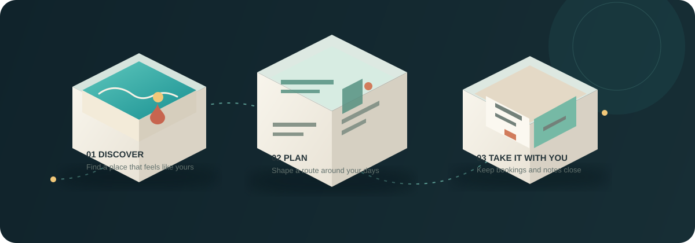
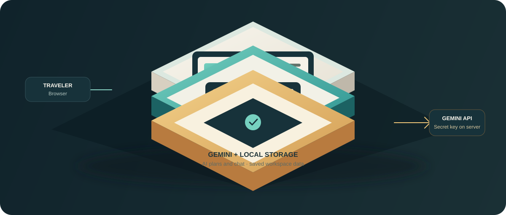

<div align="center">


# TravelAI

### A calmer way to plan the trip you can’t stop thinking about.

Discover places, shape an itinerary, compare experiences, and keep the details together in one travel workspace.

<p>
  <a href="https://github.com/Tejas-c-0/Travel-AI"></a>
  
  
  
  
</p>

[Explore the app](https://github.com/Tejas-c-0/Travel-AI) · [Run it locally](#-run-locally) · [Deploy on Render](#-deploy-on-render)

</div>

<br />

## The trip, from first idea to saved plan

TravelAI brings discovery and planning into one flow. Start with a place, tune the trip to your travel style, then keep the plan and booking details close at hand.

<div align="center">
  
</div>

## What you can do

| Discover | Plan | Keep it together |
| --- | --- | --- |
| Browse destinations, local experiences, costs, and travel notes. | Build a trip around your dates, group size, budget, and travel style. | Review bookings, saved places, wallet activity, and trip notes. |
| Filter by budget and safety score, then open a place for details. | Ask the AI planner for an itinerary and refine the route. | Use the travel assistant, community feed, and dashboard in the same workspace. |

## Under the hood

The interface is a React single-page app. Express serves the production build and handles AI requests; Gemini powers itinerary generation and chat when an API key is configured.

<div align="center">
  
</div>

### Project map

```text
src/
  App.tsx                 App shell, navigation, and shared state
  components/             Explore, planner, bookings, wallet, and other screens
  utils/                  Browser storage and toast helpers
server.ts                 Express API and production static-file server
docs/images/              README diagrams
render.yaml               Render deployment blueprint
```

## Quick start

### Requirements

- Node.js 20 or newer
- npm
- A Gemini API key for AI itinerary and chat features

### Run locally

```bash
git clone https://github.com/Tejas-c-0/Travel-AI.git
cd Travel-AI
npm install
```

Copy `.env.example` to `.env.local`, then set your Gemini key:

```dotenv
GEMINI_API_KEY=your_gemini_api_key
```

Start the app:

```bash
npm run dev
```

Open [http://localhost:3000](http://localhost:3000).

### Useful commands

| Command | What it does |
| --- | --- |
| `npm run dev` | Starts the Express server with the Vite development middleware. |
| `npm run lint` | Runs the TypeScript check. |
| `npm run build` | Builds the web app and bundles the production server. |
| `npm start` | Serves the production build. |

## Deploy on Render

The repository includes [`render.yaml`](./render.yaml) as a Render Blueprint. After pushing the repository:

1. In Render, choose **New → Blueprint** and connect this repository.
2. Add `GEMINI_API_KEY` as a secret environment variable when prompted.
3. Deploy the `travel-ai` web service on Render’s free instance tier.

The service uses `npm install && npm run build` to build and `npm start` to run. It reads Render’s `PORT` environment variable and falls back to `3000` for local use.

> **No API key?** The app shell still runs, but AI-powered planning and chat need `GEMINI_API_KEY`.

## API endpoints

| Method | Path | Purpose |
| --- | --- | --- |
| `POST` | `/api/generate-plan` | Creates a travel itinerary. |
| `POST` | `/api/chat` | Sends a message to the travel assistant. |

## Notes for contributors

- Login and social sign-in currently use **simulated demo flows**. They do not deliver real OTP codes or authenticate with Google or Apple.
- User preferences and much of the trip workspace are stored in browser `localStorage`.
- Never commit `.env.local` or real API keys. Use your hosting provider’s secret manager for deployed credentials.
- Destination photos currently load from Unsplash URLs.

## License

No license file is currently included. Contact the repository owner before redistributing this project.

<div align="center">

---

Made for the places that stay with you.

</div>
